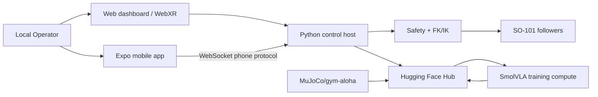

# Container Architecture

> **Legacy subsystem view.** This diagram describes the local robot-learning and
> teleoperation containers. The canonical education-platform container diagram
> is [C4 Level 2 — Containers](../diagrams/architecture/c4-2-container.md), with
> the complete diagram index in [VISTA Diagrams](../diagrams/README.md). Use the
> canonical diagram for Report 4 and this file only for runtime implementation
> detail.

Control host is the USB serial owner. `web/checkIk` contains the current teleop/control path; .NET backend, AI integration and Pi agent are not the hardware-control source of truth in the inspected baseline.

