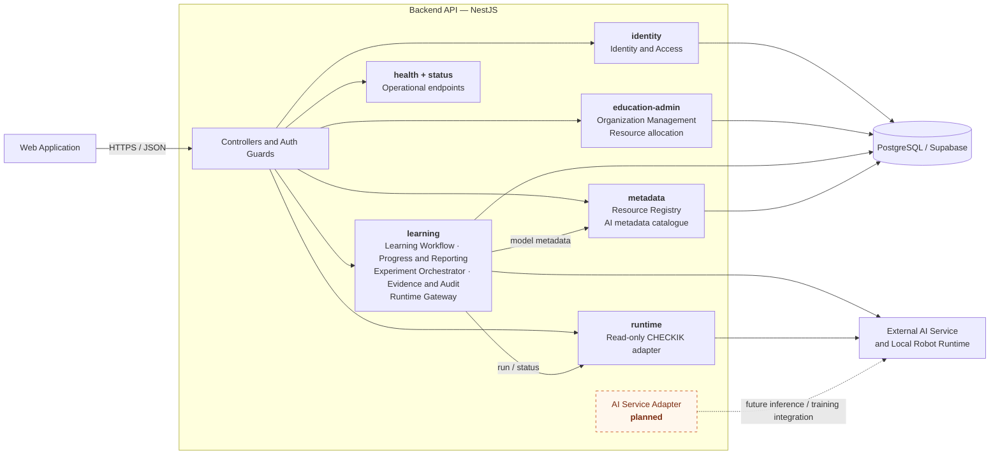

# C4 Level 3 — Backend API Components

Source: draw.io page 03 (Report 4, Figure 03). This version maps the
design-level component names used in Report 4 to the NestJS modules that exist
in `services/education-api/src/modules`.

The diagram uses a Mermaid flowchart instead of the experimental C4 renderer so
the grouping remains readable in GitHub previews and exported report images.

## Design-to-code mapping

| Report 4 component | Current code owner | Status |
|---|---|---|
| Identity and Access | `identity` | Implemented |
| Organization Management | `education-admin` | Implemented |
| Learning Workflow | `learning` | Implemented |
| Progress and Reporting | `learning` | Implemented |
| Resource Registry | `education-admin` for allocation; `metadata` for model, dataset and benchmark catalogues | Partially split across implemented modules |
| Experiment Orchestrator | `learning` (`experiment.service`, `physical-execution.service`) | Implemented |
| AI Service Adapter | No write/inference provider adapter; `metadata` exposes read-only AI metadata | Planned |
| Evidence and Audit | `learning` assessment/evidence queries; `metadata` provenance reads | Partial |
| Runtime Gateway | `learning/robot-runtime.client` for execution; `runtime` for read-only CHECKIK status | Implemented boundary |
| Operational endpoints | `health`, `status` | Implemented; not a separate Report 4 business component |
