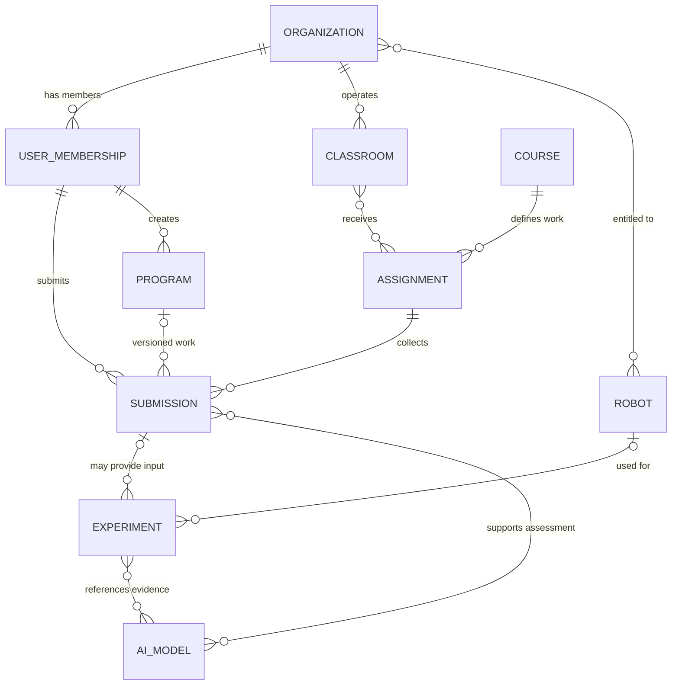

# Conceptual ERD

Source: draw.io page 12 (Report 4, Figure 12). Entities and relationships only — no attributes, no keys. Many-to-many links (Classroom–Assignment, Organization–Robot…) become junction tables in the logical/physical model.

> **Note:** the 3rd and 4th many-to-many links (Experiment–AI Model, Submission–AI Model) have no direct foreign key in the schema; they are conceptual only.
