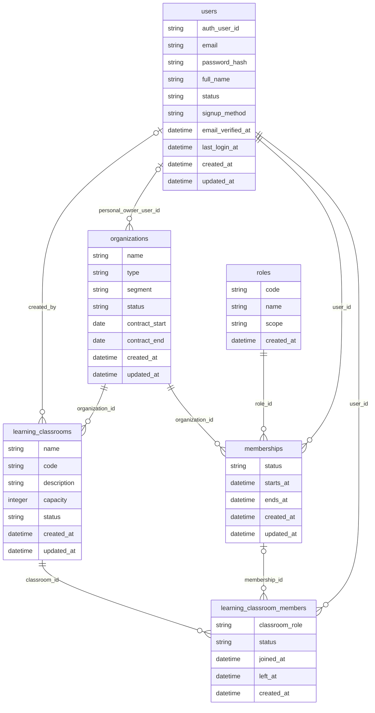
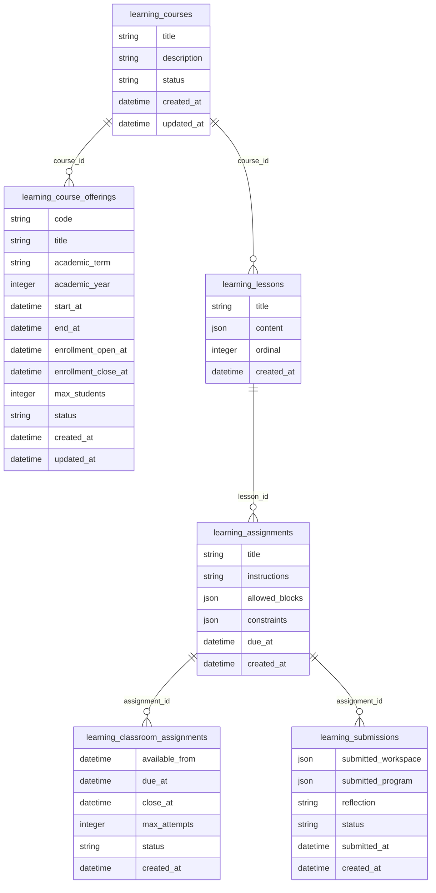
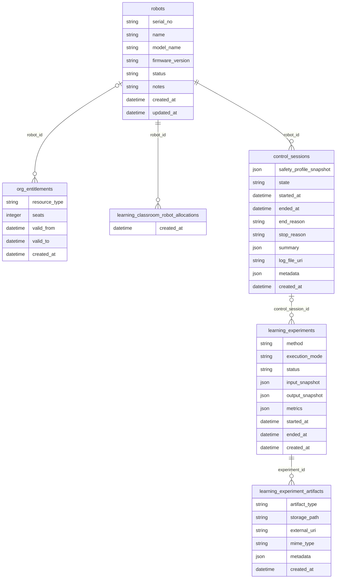
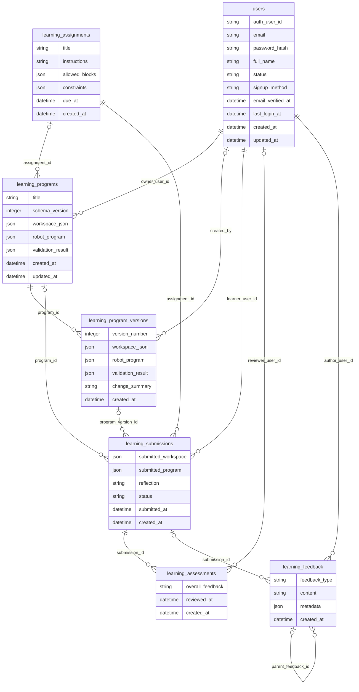
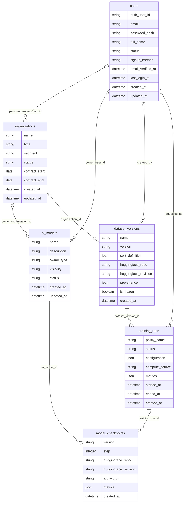

# Logical ERD

One diagram per page of the draw.io set (13, 14, 15, 16a, 16b). Entities, business attributes and relationships; keys (`id`, `*_id`) are expressed by the relationship lines, as in the Logical ERD of Report 4. Mermaid `erDiagram` requires a datatype on every attribute, so platform-independent logical types are used (`string`, `integer`, `decimal`, `boolean`, `date`, `datetime`, `json`).

Relationship ends: `||` exactly one, `|o` zero or one, `o{` zero or many; the label is the FK column on the child table. Relationships come from the Prisma `@relation` definitions and are drawn only when both tables are on the same diagram.

## 13 Logical ERD — SCHOOL & ACCESS

Source: draw.io page "13 Logical ERD — SCHOOL & ACCESS". Attributes are read from `services/education-api/prisma/schema.prisma`.

## 14 Logical ERD — CURRICULUM & ASSESSMENT

Source: draw.io page "14 Logical ERD — CURRICULUM & ASSESSMENT". Attributes are read from `services/education-api/prisma/schema.prisma`.

## 15 Logical ERD — ROBOTS & EXPERIMENTS

Source: draw.io page "15 Logical ERD — ROBOTS & EXPERIMENTS". Attributes are read from `services/education-api/prisma/schema.prisma`.

## 16a Logical ERD — Programs & Assessment

Source: draw.io page "16a Logical ERD — Programs & Assessment". Attributes are read from `services/education-api/prisma/schema.prisma`.

## 16b Logical ERD — AI & Datasets

Source: draw.io page "16b Logical ERD — AI & Datasets". Attributes are read from `services/education-api/prisma/schema.prisma`.

