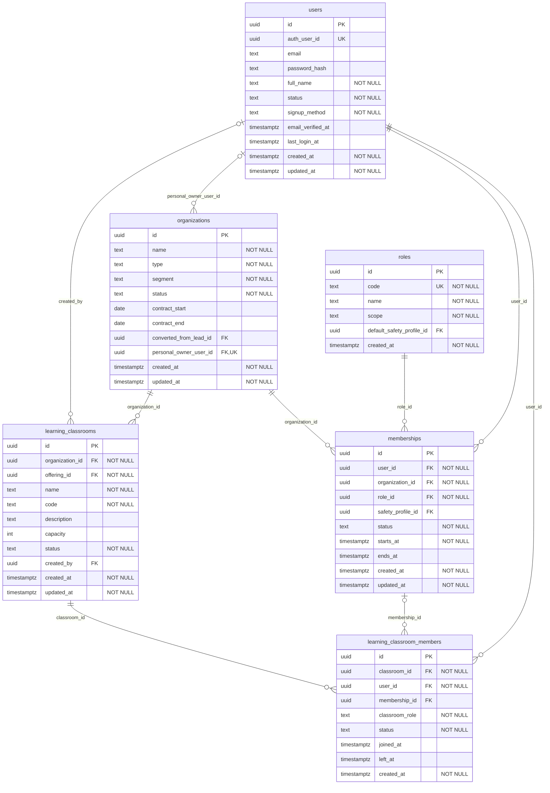
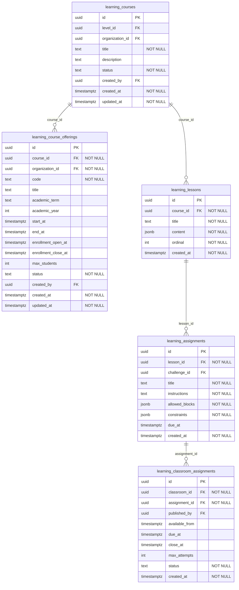
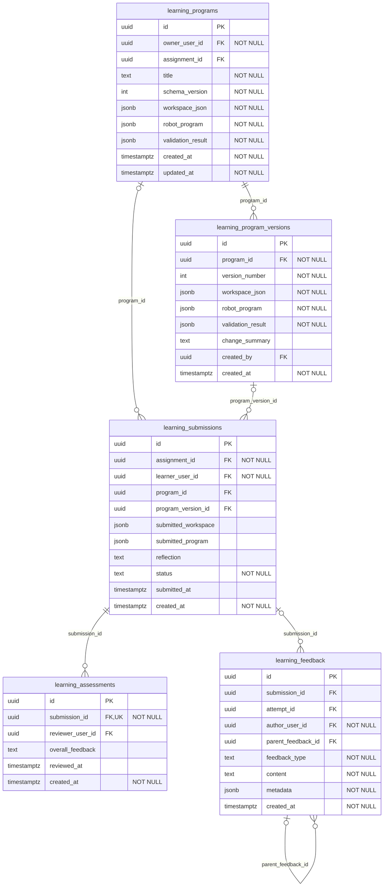
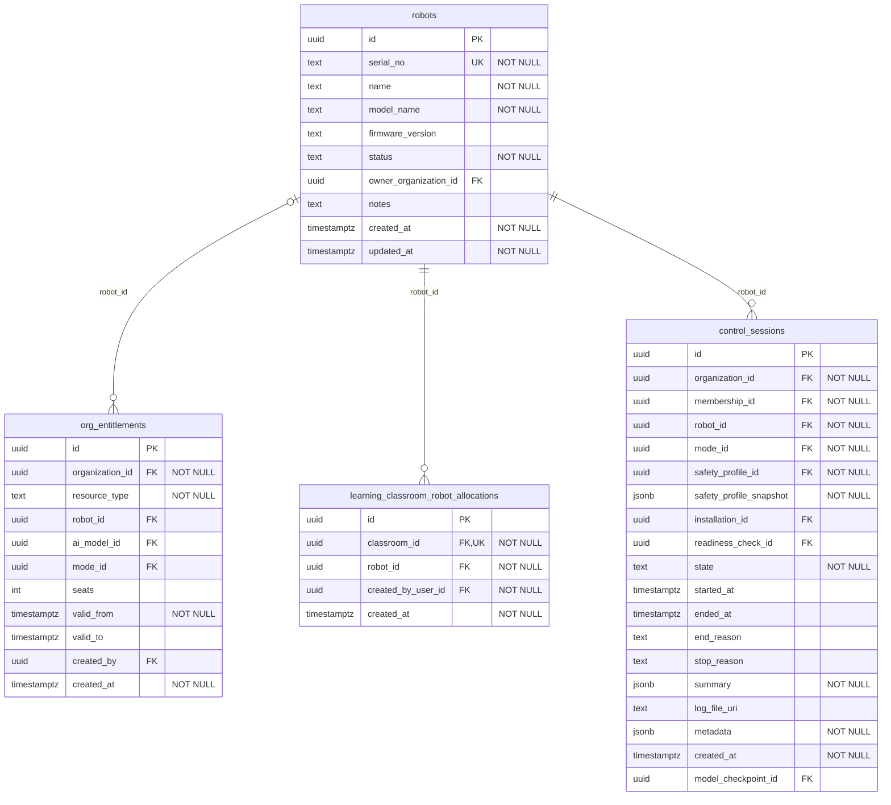
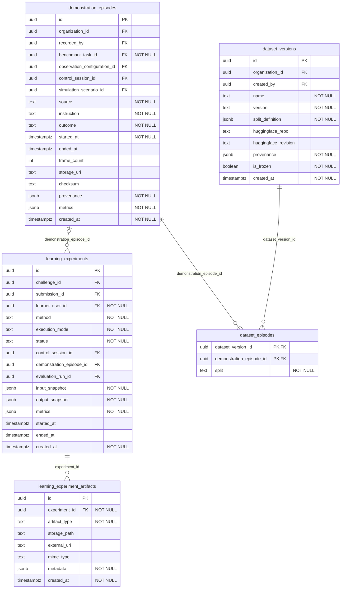
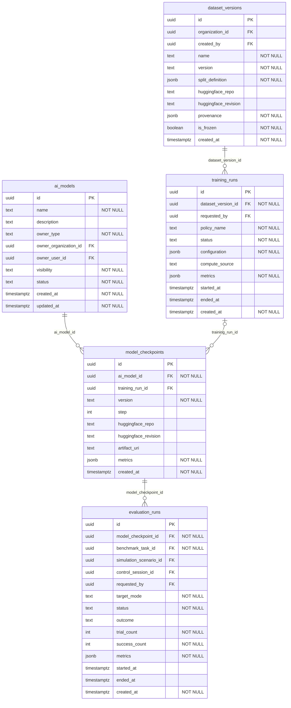

# Physical ERD

One diagram per page of the draw.io set (17 to 22): tables, all columns, datatypes, PK / FK / UK and NOT NULL, read from `services/education-api/prisma/schema.prisma`.

Relationship ends: `||` exactly one, `|o` zero or one, `o{` zero or many; the label is the FK column on the child table.

## 17 Physical ERD — IDENTITY & SCHOOL

Source: draw.io page "17 Physical ERD — IDENTITY & SCHOOL". Attributes are read from `services/education-api/prisma/schema.prisma`.

## 18 Physical ERD — CURRICULUM

Source: draw.io page "18 Physical ERD — CURRICULUM". Attributes are read from `services/education-api/prisma/schema.prisma`.

## 19 Physical ERD — PROGRAMS & ASSESSMENT

Source: draw.io page "19 Physical ERD — PROGRAMS & ASSESSMENT". Attributes are read from `services/education-api/prisma/schema.prisma`.

## 20 Physical ERD — ROBOT RESOURCES

Source: draw.io page "20 Physical ERD — ROBOT RESOURCES". Attributes are read from `services/education-api/prisma/schema.prisma`.

## 21 Physical ERD — EXPERIMENT

Source: draw.io page "21 Physical ERD — EXPERIMENT". Attributes are read from `services/education-api/prisma/schema.prisma`.

## 22 Physical ERD — AI & MODEL LIFECYCLE

Source: draw.io page "22 Physical ERD — AI & MODEL LIFECYCLE". Attributes are read from `services/education-api/prisma/schema.prisma`.

