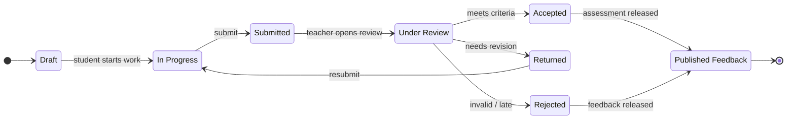

# State Machine — Learning Submission

Source: draw.io page 10 (Report 4, Figure 10). Entity: `learning_submissions / learning_assessments`.

> **Status: proposed.** State names are design-level. The code stores status as free-form strings (see `docs/review-2/05-tracking/repo-audit/CODE_AUDIT.md`); before sign-off, map each state here to the persisted value or rename it to match.
