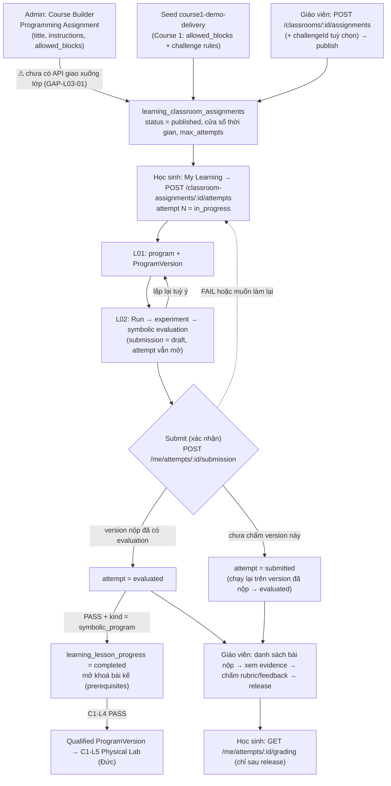
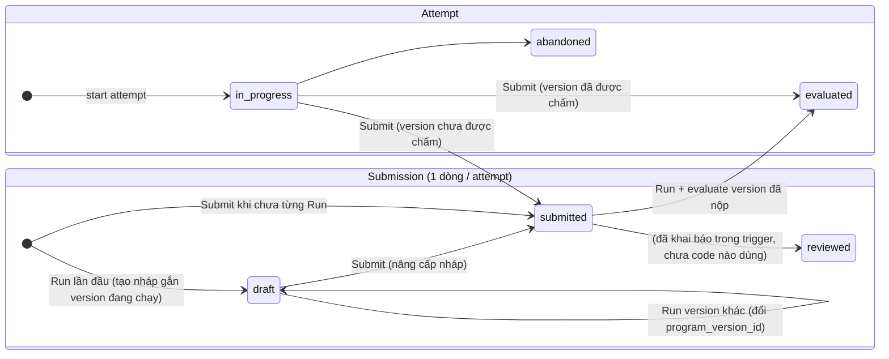

# L03 — Programming Assignment & Assessment Flow (end-to-end)

> Domain owner: Phạm Viết Lợi · Audit ngày 15/11/2026 trên `develop` @ `a8bcae5` (audit trên `main` @ `b8ac12f`, kiểm chứng lại trên `develop`) · Trạng thái: **Audit xong, chờ Đức review**
>
> Phạm vi: bài lập trình đi từ lúc **được soạn → giao cho lớp → học sinh bắt đầu attempt → lập trình (L01) → chạy thử (L02) → nộp
> → giáo viên chấm và phát hành điểm → tiến độ khoá học**, và điểm bàn giao sang chạy robot thật.
> Grading và Quiz Engine thuộc Đức (chỉ mô tả, không sửa). Physical Execution, MQTT và MuJoCo thuộc Đức.

## 1. Tóm tắt một phút (dùng khi trình bày)

1. Mỗi lần học sinh làm bài là một **attempt** (lần 1, 2, …). Mỗi attempt có **một program**, nhiều **version bất biến**, nhiều lần
   **chạy thử**, và **tối đa một bài nộp cuối** (ràng buộc trong DB từ migration J).
2. **Chạy thử (Run)** không phải nộp bài: không khoá, không tính điểm, không mở khoá bài sau. **Nộp (Submit)** là hành động cuối, có hộp
   xác nhận: khoá attempt, chụp lại chương trình, và nếu version nộp đã được chấm PASS **và bài là template giáo trình
   (`constraints.kind = "symbolic_program"`)** thì **hoàn thành bài + mở khoá bài tiếp theo**. Bài do giáo viên tự tạo vẫn nộp được với
   trạng thái `evaluated`, nhưng không hoàn thành lesson (thay đổi `0c818bb` trên `develop`).
3. Giáo viên chỉ thấy bài **đã nộp** (không thấy nháp hay các lần chạy thử). Điểm và nhận xét **ẩn với học sinh cho tới khi giáo viên release**.
4. Bài L4 PASS tạo ra **ProgramVersion qualified**. Bài L5 (robot thật) chỉ được chạy đúng version đó. Phần chạy robot do Đức phụ trách.

## 2. Luồng tổng thể

## 3. Máy trạng thái

- Sau khi nộp, submission **bất biến**: trigger `guard_learning_submission_attempt` (migration J) chặn mọi sửa đổi nội dung.
- Draft không bao giờ xuất hiện trong danh sách bài nộp của giáo viên hay của học sinh (`status <> 'draft'`).

## 4. API contract theo từng bước

| Bước | Endpoint | Ai | Quy tắc chính & lỗi |
| --- | --- | --- | --- |
| Soạn template | `GET/PUT /author/activities/:activityId/programming-assignment` `{title, instructions, allowedBlocks[]}` | System admin / tác giả | `allowedBlocks` khác rỗng, không trùng, thuộc 6 capability; khoá sửa khi đã giao hoặc khoá học đã archive (409) |
| Giao cho lớp | `POST /classrooms/:classroomId/assignments` `{lessonId, title, instructions?, challengeId?}` → `POST /classrooms/:id/assignments/:assignmentId/publish` | Giáo viên/TA của lớp, school admin | Lesson phải thuộc khoá của lớp; challenge phải `published`, cho phép `blockly`, có điều kiện `success`. Lớp phải `active` mới publish được (409) |
| Bắt đầu làm | `POST /classroom-assignments/:id/attempts` | Học sinh | Bài `published`, trong cửa sổ `available_from…close_at`, lớp và offering `active`, enrollment `active`, **đã hoàn thành bài tiên quyết** (409 `PREREQUISITE_NOT_COMPLETED`), chưa vượt `max_attempts`. Đang có attempt `in_progress` thì trả lại attempt đó (khoá advisory, không tạo trùng) |
| Lập trình | xem [L01](L01-blockly-programming-validation.md) | Học sinh | |
| Chạy thử | xem [L02](L02-schematic-experiment-symbolic-evaluation.md) | Học sinh | |
| Nộp | `POST /me/attempts/:attemptId/submission` `{programVersionId: uuid, reflection?: string≤5000}` | Học sinh | 503 nếu DB chưa có Stage 2 · version phải thuộc program của attempt (400) · kiểm tra lại allowed-blocks + workspace (400) · còn file đính kèm đang upload: 409 `ATTACHMENT_PENDING` · đã nộp rồi: 409 `ALREADY_SUBMITTED` · attempt đóng: 409 `ATTEMPT_NOT_IN_PROGRESS` / `ASSIGNMENT_CLOSED` · enrollment mất: 404 |
| Lịch sử | `GET /me/classroom-assignments/:id/attempts`, `GET /me/attempts/:attemptId`, `GET /me/submissions` | Học sinh | Đọc được cả khi đã bị thu hồi enrollment (giữ lịch sử) |
| Giáo viên xem | `GET /classrooms/:classroomId/submissions`, `GET /submissions/:id` (kèm program version, experiment, evaluation, file) | Giáo viên/TA, school admin | Chỉ thấy lớp mình phụ trách |
| Chấm / nhận xét | `POST /submissions/:id/assessment`, `POST /submissions/:id/feedback` | Giáo viên | Thuộc Đức (grading) |
| Phát hành điểm | `POST /attempts/:attemptId/release` (hoặc `/submissions/:id/release`) | Giáo viên | Trước khi release, học sinh chỉ nhận `released:false` |
| Học sinh xem điểm | `GET /me/attempts/:attemptId/grading` | Học sinh | |
| Tiến độ | `GET /me/courses/:courseId/path` | Học sinh | Trạng thái `completed/current/available/locked` kèm lý do khoá |
| Bàn giao L5 | `GET /me/courses/:courseId/qualification/c1-l4`, `GET /me/attempts/:id/physical-execution-eligibility` | Học sinh | Thuộc Đức (Physical Execution) |

## 5. Quy tắc nghiệp vụ quan trọng (giải thích được khi bị hỏi)

| Câu hỏi thường gặp | Trả lời (theo code hiện tại) |
| --- | --- |
| Run nhiều lần có bị trừ lượt không? | Không. `max_attempts` chỉ đếm **attempt**. Run không tạo attempt mới và không khoá attempt. |
| Nộp version chưa chạy thử thì sao? | Vẫn nộp được. Attempt chuyển sang `submitted` (chưa `evaluated`), lesson **chưa** hoàn thành. Học sinh chạy thử lại đúng version đã nộp → attempt `evaluated`, nếu PASS thì hoàn thành bài. |
| Nộp version FAIL thì sao? | Attempt `evaluated` với verdict failed, lesson **không** hoàn thành. Muốn làm lại phải bắt đầu attempt mới. |
| Làm lại (attempt 2) có mất kết quả lần 1 không? | Không. Mỗi attempt có submission, version và evidence riêng (đã có test trên PostgreSQL thật). |
| Bài giáo viên tự tạo (có challenge) PASS thì có hoàn thành lesson không? | Không. Từ `0c818bb` (develop), chỉ template giáo trình (`kind = symbolic_program`) mới chiếu PASS sang tiến độ. Bài giáo viên tạo vẫn nộp được, attempt `evaluated`. Trước bản sửa đó, việc nộp bị rollback do lỗi 409. |
| PASS hai lần có cộng tiến độ hai lần không? | Không. Hoàn thành bài là idempotent (khoá advisory + `ON CONFLICT`). |
| Bị thu hồi enrollment giữa chừng? | Mọi thao tác ghi (tạo program, version, run, nộp) bị chặn. Lịch sử vẫn đọc được. |
| Học sinh khác xem được bài của mình không? | Không. Mọi truy vấn lọc theo chủ sở hữu, và trả 404 để không tiết lộ dữ liệu tồn tại. |
| Ai quyết định PASS? | Chỉ server: rule trong DB + mô phỏng do server chạy trên version bất biến. Đã có test chứng minh verdict giả từ trình duyệt bị bỏ qua. |

## 6. Bàn giao sang Physical Execution (chỉ cần hiểu, Đức phụ trách)

- `ProgressionService.resolveQualifiedL4ProgramVersion` tìm **evaluation PASS gần nhất** của bài C1-L4 có submission `submitted`.
  Version đó là bản qualified (đã có test P0.8 A–L).
- `PhysicalExecutionService` chỉ cho chạy khi version của submission trùng bản qualified, có symbolic PASS khớp, lớp được cấp robot,
  có entitlement và có safety profile.
- **Điểm gãy cần báo Đức (GAP-L03-04):** chương trình L4 bắt buộc dùng `preview.move_xyz`, nhưng Robot Runtime chỉ nhận
  `arm.select, home, gripper.open, gripper.close, wait`, và chưa có phép đổi khung toạ độ `learning_preview_v1` sang robot thật.

## 7. Bằng chứng kiểm thử

| Suite | Kết quả | Chứng minh |
| --- | --- | --- |
| `attempt-retry-regression.db.spec.ts` (PostgreSQL thật) | 9/9 | Run không khoá/không tiêu attempt và không hiện như bài nộp; Submit là hành động cuối duy nhất; submit chưa có evaluation → `submitted`; attempt 2 không ảnh hưởng attempt 1; thống kê lớp chỉ đếm bài nộp |
| `attempt-submissions.db.spec.ts` (PostgreSQL thật) | 10/10 | Không nộp hai lần; không sửa sau khi nộp; chấm và release theo từng attempt; học sinh khác không xem được; thu hồi enrollment chặn ghi; cửa sổ thời gian; file đính kèm |
| `attempt-lifecycle.spec.ts` | 18/18 | Quy tắc attempt mở/đóng, cửa sổ thời gian, đính kèm theo loại bài |
| `p08-simulation-result-handoff.spec.ts` | 19/19 | Xác định version qualified L4 → L5 |
| Web: `Practice.spec.tsx`, `SimulationResult.spec.tsx`, `submission-ui.spec.tsx`, `submissionState.spec.ts`, `c1EvidenceOrchestrator.spec.ts` | đạt | UI tách Run/Submit, hiển thị kết quả, lịch sử, trạng thái nộp |

Chi tiết: [evidence/2026-11-15-test-evidence.md](evidence/2026-11-15-test-evidence.md).

## 8. Phần chưa có / chưa kiểm chứng E2E

Xem đầy đủ trong [GAP-LIST.md](GAP-LIST.md). Tóm tắt:

- **Chưa có đường sản phẩm để giáo viên/admin giao một bài lập trình có `allowed_blocks` + rule chấm tự động.** Course 1 chạy được là nhờ seed (GAP-L03-01, GAP-L03-02).
- **Chưa có E2E qua trình duyệt với Supabase Auth thật** trong đợt này. Mọi kiểm chứng đều ở mức service/DB (unit + PostgreSQL thật).
  Video demo cần làm thủ công theo [README §4](README.md#4-kịch-bản-demo-quay-video).
- **Chưa chạy trên robot thật.** Không claim bất kỳ kết quả phần cứng nào.
