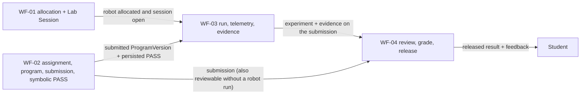

# WF-01 … WF-04 — consolidated definition and review package

Purpose: let the owner review and finalize the exact behaviour of the four registered workflows without re-reading the codebase. Exactly four workflows exist; **no WF-05 is introduced**. Nothing here changes behaviour.

**Labels used in every section**
- **[APPROVED]** — taken from the repository's approved activity diagrams (`docs/diagrams/workflows/activity-wf0N-*.md`, draw.io Report 4 figures 04–07) and gate documents (`docs/education/wf-*.md`, `WF01-WF04-INTEGRATION-BASELINE.md`).
- **[CURRENT]** — what the code on `develop` (2026-11-27) actually does (file references given).
- **[PROPOSED]** — an improvement suggested by this review; not implemented.
- **[OWNER DECISION]** — a question that needs the owner's explicit answer.

Evidence status vocabulary: PASS / FAIL / BLOCKED / NOT RUN (Production revision `430ad59` unless stated; local = isolated stack).

## 0. Overview

| WF | Approved name | Primary actor | One-line purpose |
|---|---|---|---|
| WF-01 | School Administration & Robot Resource Allocation | School Admin | Allocate an entitled robot resource to a classroom; the instructor sees it. **Refined 2026-11-27** with Robot Resource management (System Admin), many-to-many allocation and the **Classroom Lab Session** (instructor reserves the robot). |
| WF-02 | Learning & Assignment Management | Teacher (author) → Student | Teacher creates/edits a lesson and assignment, publishes; student views assigned work, builds and submits a program/work item; API records the submission (and the symbolic evaluation that gates WF-03). |
| WF-03 | Robot Experiment Execution | Student | Student runs the submitted program; API validates auth/assignment/robot; the Robot Runtime executes and returns status + telemetry; API stores result + evidence; student sees result or error. |
| WF-04 | AI/Data Integration & Teacher Review | Teacher | Evidence + model metadata are linked to the submission; teacher reviews evidence, scores the rubric, gives feedback, releases; student sees the released result. |

Cross-workflow dependencies: WF-03 cannot start without WF-02's submitted ProgramVersion and persisted symbolic PASS, and without WF-01's allocation + entitlement + open Lab Session. WF-04 reads WF-02 submissions and WF-03 experiment evidence. Release of grades is attempt-level and shared by every assignment type.

---

## WF-01 — School Administration & Robot Resource Allocation

1. **Name / purpose.** [APPROVED] Allocate an entitled robot resource to a classroom so its instructor can use it. [CURRENT] Adds the Lab Session (exclusive time-boxed reservation by one classroom).
2. **Primary actor.** School Admin (allocation). Instructor (Lab Session).
3. **Supporting actors.** System Admin (registers robot resources, grants organization entitlements); Student (blocked/enabled by session); Robot Runtime (confirms stop on End).
4. **Preconditions.** Robot resource exists (`robots`), organization has a valid entitlement (`org_entitlements`, `valid_from<=now()<valid_to`), classroom active, robot status available. Lab Session: instructor has `education.lab_session.manage` for the classroom; robot allocated, entitled, not disabled, not held by another classroom.
5. **Trigger.** School Admin opens a classroom (allocation); instructor clicks Start Lab Session.
6. **Main success flow.** [APPROVED] Open School Admin → select classroom → Web lists eligible robots → choose robot → API validates scope, entitlement, conflict → creates classroom robot allocation → instructor views the allocated robot. [CURRENT, refinement] Instructor Start Lab Session → reservation `active` (default 120 min) → student eligibility changes from `LAB_SESSION_NOT_ACTIVE` to eligible → Extend (5–60 min, ≤480 total) → End → `terminating` → `released` once the runtime confirms the stop.
7. **Alternative flows.** Replace allocation; remove allocation; idempotent Start by the same classroom returns the open session; expiry triggers the same controlled termination as End; entitlement revoked / robot disabled terminates the session.
8. **Exception flows.** 403 outside scope, 404 for unknown/foreign resources, 409 conflict (`ROBOT_RESERVED_BY_ANOTHER_CLASSROOM`, partial-unique-index race, `MULTI_ROBOT_ALLOCATION` on the old schema); 503 `LAB_SESSION_SCHEMA_NOT_READY` on an old schema; `quarantined` when the runtime cannot confirm the stop (robot stays blocked).
9. **Frontend.** `/admin/robots` (System Admin: register, entitle, inspect), `/school/classrooms/:id` (allocation panel; Force End), `/teacher/classes/:id` (`LabSessionPanel`: Start, Extend 30 min, Stop execution, End, Retry release).
10. **Endpoints.** `GET /education-admin/classrooms/:id/eligible-robots`; `POST|DELETE /education-admin/classrooms/:id/robot-allocations[/:robotId]` (legacy `PUT …/robot-allocation`); `GET|POST /education-admin/robots`, `PATCH …/:id`, `POST|DELETE …/:id/entitlements`; `GET /classrooms/:id/lab-robots`; `GET|POST /classrooms/:id/lab-sessions`; `POST /lab-sessions/:id/{extend,stop-execution,end,force-end}`.
11. **Services.** `education-admin` robot/allocation services; `lab-session.service.ts` (+ scheduled reaper for expiry/terminating/quarantined); `LabSessionSchemaProbe`.
12. **Entities.** `robots`, `org_entitlements`, classroom robot allocations (`UNIQUE(classroom_id, robot_id)`), `classroom_lab_sessions` (partial unique index `ux_classroom_lab_sessions_one_open_per_robot`), audit logs.
13. **State transitions (Lab Session).**

| From | Event | To |
|---|---|---|
| — | Start (instructor) | `active` |
| `active` | Extend | `active` (expiry moved) |
| `active` | End / Force End / expiry / entitlement revoked / robot disabled | `terminating` (no new runs; stop requested) |
| `terminating` | runtime confirms stop (or no run) | `released` |
| `terminating` | cannot confirm stop | `quarantined` (robot blocked) |
| `quarantined` | run finishes / runtime reports stopped / retry | `released` |

14. **Authorization.** System Admin: global resources + entitlements. School Admin: only its organization's classrooms/robots; Force End with reason ≥5 chars and confirmation. Instructor: only classrooms they teach. Student: cannot create/extend/end. Cross-organization requests → 404.
15. **Contracts.** Start body `{robotId}`; response session DTO (`id, state, classroomId, robotId, expiresAt, recovery?`). Robot DTO has separate fields: connectivity, reservation, control ownership, safety; derived UI states Offline / Available / Reserved for this classroom / Reserved by another classroom / In use / Ending session / Safety blocked / Unavailable.
16. **Evidence/artifacts.** Audit log rows for allocation, session start/end/force end (with reason).
17. **Error handling.** Idempotent retries; advisory lock per robot + unique index prevent double reservation; schema probe returns 503 not 500.
18. **Safety.** Starting a session never arms hardware and sends no command; End asks the runtime to stop and releases only when confirmed; Emergency Stop is local to the Edge and never cloud-dependent (not implemented for physical hardware).
19. **Completion.** Allocation visible to the instructor; session reserved/released with the robot shown Available again and students blocked again.
20. **Existing tests.** Real-PostgreSQL `lab-session.db.spec`, `robot-resource.db.spec`, `robot-allocation.db.spec`, `lab-session-compat.db.spec`; unit `lab-session-stop.spec`, `lab-session-safe-stop.spec`; Playwright `lab-session-management.spec.ts` (4 tests; local 4/4), `lms-robot-lab-access.spec.ts`. Production: allocation + Start/End **PASS** (`43dcb60`, `430ad59`); Extend, Force End, Stop, concurrent Start from two classrooms, expiry, quarantine on Production **NOT RUN**.
21. **Gaps.** No physical-robot stop; Stop Execution is hard to exercise on Production (0.5 s run); session list/history UI is minimal.
22. **[OWNER DECISION]** (a) Is the Lab Session part of the final WF-01 definition or a separate approved extension (the baseline documents call it a refinement, not a workflow)? (b) Default 120 min / max 480 min acceptable? (c) May an instructor extend beyond the 480-minute cap with School Admin approval?

23. **[REFINEMENT 2026-11-28, owner-approved requirement] Account provisioning inside WF-01 (not a new workflow).** The school administration actor must be able to provision accounts by two independent methods: **A. Direct account creation** (server-generated one-time temporary password, no e-mail needed, mandatory server-enforced first-login password change) and **B. E-mail invitation** (Supabase invitation, user sets the password). System Admin provisions School Administrators; a School Admin provisions Instructors and Students of that school only. Existing never-signed-in invited accounts are recoverable in place. Implementation, flag `STAFF_TEMP_PASSWORD_ENABLED`, staged migration U and the 30 acceptance cases: `FINAL_SYSTEM_ACCEPTANCE_20261128/AUTH_PROVISIONING_ACCEPTANCE.md`.

---

## WF-02 — Learning & Assignment Management

1. **Name / purpose.** [APPROVED] Teacher creates/edits lesson and assignment, publishes; student views assigned work and submits a program/work; API records the submission.
2. **Primary actor.** Teacher (authoring), Student (attempt/submission).
3. **Supporting.** School Admin (course offerings, enrolment), Backend API, Symbolic evaluator.
4. **Preconditions.** Published course/lesson/offering for the classroom; student enrolled and active; assignment published and inside its window; attempt limits not exhausted.
5. **Trigger.** Teacher creates the assignment; student clicks Start Assignment.
6. **Main success flow.** [APPROVED] Create/edit lesson → enter assignment details → API validates + saves (draft delivery) → publish → stored published → student sees assigned work → submits program/work → API records submission. [CURRENT] Student: `POST /classroom-assignments/:id/attempts` → program (Blockly workspace) `POST /me/attempts/:id/program` → immutable ProgramVersion `POST /me/programs/:id/versions` → schematic experiment + `run-schematic` → `evaluate-symbolic` (persisted verdict) → `POST /me/attempts/:id/submission`.
7. **Alternative flows.** Draft autosave `PUT /me/attempts/:id/draft`; quiz assignments with immutable question snapshot and weighted scoring; retake within limits; unpublish; knowledge check.
8. **Exception flows.** Closed/archived assignment refused; attempt limit; symbolic FAIL (submission allowed, WF-03 blocked); duplicate/frozen-write protection after submission.
9. **Frontend.** `/teacher/assignments[/new|/:classroomId/:assignmentId[/edit]]`, `/teacher/classes/:id`, `/my-learning`, `/my-learning/:classroomAssignmentId`, `/assignments`, `/studio`, `/practice/:attemptId`, `/courses/:id/lessons/:id/activities/:id`.
10. **Endpoints.** `POST|PATCH /classrooms/:id/assignments`, `POST …/publish|unpublish`, `GET /classrooms/:id/assignments`, `GET /classroom-assignments/:id`, attempts/programs/experiments/symbolic/submission routes listed above, `GET /me/attempts`, `GET /me/submissions`.
11. **Services.** `programming.service`, assignment authoring, attempt lifecycle, `attempt-submissions`, symbolic evaluation, quiz delivery/scoring.
12. **Entities.** `learning_assignment_attempts`, `learning_programs`, `learning_program_versions`, `learning_submissions`, `learning_experiments` (schematic), `learning_symbolic_evaluations`, classroom assignments, rubric criteria.
13. **State transitions.** Assignment: `draft → published → (unpublished|closed|archived)`. Attempt: `in_progress → submitted → evaluated` (after assessment/auto-grade). Submission: `submitted`. Symbolic evaluation verdict: `passed | failed`.
14. **Authorization.** Teacher authors only in classrooms they teach (`learning.work.*`); student reads/writes only their own attempts within enrolment; publish needs the author permission; quizzes need published canonical question versions.
15. **Contracts.** Robot program = `{kind:'robot_program', schemaVersion:1, steps:[arm.select|home|gripper.open|gripper.close|wait…]}` with step limits (`robot-program-limits`).
16. **Evidence.** Immutable ProgramVersion; persisted SymbolicEvaluation; schematic experiment events.
17. **Errors.** Domain codes (`ATTEMPT_*`, validation 400/409), never 500 for rule violations.
18. **Safety.** Only canonical limited step types reach the runtime later (WF-03); no free-form commands.
19. **Completion.** Submission recorded and visible to the instructor; symbolic verdict stored.
20. **Tests.** `attempt-lifecycle.spec`, `attempt-submissions.db.spec` (incl. submit→Twin regression #255), `attempt-retry-regression.db.spec`, `programming-assignment-authoring.db.spec`, `programming-evaluation-regression.db.spec`, `robot-program-limits.spec`; Playwright `lms-assignment-grading`, `lms-authoring`, `lms-module-quiz`, `lms-robot-lab-assignment`; Production attempt→submission **PASS** (`430ad59`, attempt `92c7780c…`). Quiz/Question-Bank/Course-Builder on Production **NOT RUN** (no content; see closeout).
21. **Gaps.** Submission requires an attempt to be `in_progress`; after submission the attempt becomes `evaluated`, which is why attempt-bound Twin scopes needed the D-09 change.
22. **[OWNER DECISION]** (a) Should WF-03 be allowed before the final submission (today it requires a submitted submission)? (b) Should a symbolic FAIL block submission? (c) Is the Basic-class Blockly-only path (no Robot Lab) part of WF-02's definition?

---

## WF-03 — Robot Experiment Execution

1. **Name / purpose.** [APPROVED] Student runs the experiment; API validates auth/assignment/robot; runtime executes and returns status + telemetry; API stores result + evidence; student views result or error.
2. **Primary actor.** Student.
3. **Supporting.** Backend API, AWS IoT Core + SQS feedback worker, Edge runtime (R1 + CHECKIK fake follower today; Desktop/physical tomorrow), Digital Twin, Instructor (Lab Session / Stop).
4. **Preconditions (start gate, `physical-execution.service.ts ineligibility`).** (1) submitted ProgramVersion with robot program; (2) persisted symbolic **PASS** matching it; (3) robot allocated to the classroom; (4) organization entitlement valid; (5) **open Lab Session of the student's classroom** (`LAB_SESSION_NOT_ACTIVE` / `ROBOT_RESERVED_BY_ANOTHER_CLASSROOM`); (6) safety profile allowing Blockly (`CONTROL_SESSION_POLICY_INVALID`); (7) fresh Shadow, runtime `MOCK_RUNTIME`/`fake_follower`, `hardwareEnabled=false` in simulation (`ROBOT_NOT_READY`, `ROBOT_RUNTIME_UNAVAILABLE`); (8) no other active control session on the robot.
5. **Trigger.** Student confirms the three simulation (or physical) safety statements and clicks Confirm & Run.
6. **Main success flow.** `POST …/physical-executions/start` → experiment `queued` + control session → IoT command published → Edge ack → `executing` → telemetry (SIMULATION frames) → `completed` → experiment `succeeded` → API persists evidence (`vista.experiment.telemetry.v1`) → student sees "Simulation Run Succeeded" (+ "Evidence Persisted" only when stored) and the Digital Twin (attempt-bound scope, post-#262).
7. **Alternative flows.** Student Stop (`POST /me/physical-executions/:id/stop`); instructor Stop Execution (`POST /lab-sessions/:id/stop-execution`, MQTT `cancel`); End Lab Session while running (safe stop); retry after failure.
8. **Exception flows.** Runtime offline/stale Shadow → blocked; command TTL expiry → failed; duplicate/stale feedback ignored; evidence storage failure → run still `succeeded`, evidence `unavailable` (truthful); stop unconfirmed → session `quarantined`.
9. **Frontend.** Student run panel in `ActivityReader` (`Confirm & Run Local Simulation`, status, Emergency Stop button, Digital Twin panel, evidence link); `/practice/:attemptId`; `/lab` (Robot Lab: connection, camera, experiment history).
10. **Endpoints.** `GET /me/attempts/:id/physical-execution-eligibility`, `POST …/physical-executions[/start]`, `GET /me/physical-executions/:id`, `POST …/:id/stop`, `GET …/physical-executions/active`; Twin: `POST /me/attempts/:id/digital-twin/viewer-scope` (attempt-bound), `POST /robots/:robotId/digital-twin/viewer-scope` (robot-wide, existing purpose); evidence: `GET /me/experiments/:id/{artifacts,events,result}`, `…/evidence/:artifactId/download`.
11. **Services.** `physical-execution.service`, `iot-command`, `iot-feedback` worker (SQS), `iot-telemetry.bridge` (SIMULATION), `iot-physical-telemetry.bridge`, `experiment-evidence.service/storage` (S3 `learning-media/experiments/…`), `digital-twin-*` (scope broker, telemetry client, revocation), R1 `services/robot-runtime`, `services/digital-twin`.
12. **Entities.** `learning_experiments`, `learning_experiment_events` (`physical_execution_prepared, queued, iot_ack_acknowledged, iot_status_executing, simulation_telemetry_latest, iot_status_completed`), `learning_experiment_artifacts`, `control_sessions`, `safety_profiles`.
13. **States.** Experiment `queued → running → succeeded | failed | cancelled | stopped`; control session states per `CONTROL_SESSION_STATES`; IoT lifecycle `queued → acknowledged → executing → completed|failed|timed_out`.
14. **Authorization.** Student only for their own attempt; entitlement + allocation + Lab Session gate; viewer scopes signed HMAC, attempt-bound (student) or robot-wide (staff tooling, retained); Twin enforces org + robot + attempt match; evidence read: student owner, instructor of the classroom, nobody else.
15. **Contracts.** Command/ack/status/telemetry envelope in `EDGE_CONTRACT_HANDOFF_20261126.md` (topics `vista/demo/robots/<robot>/{commands,ack,status,telemetry}`, mTLS client id = Thing name). Telemetry frame: `{schema_version, robot_id, source_mode, controller_id, sequence, measured_at, connection, measured[6 joints]}`.
16. **Evidence.** JSON artifact + metadata (sha256, size) stored under the experiment's student/classroom/organization key; association by experiment, student, classroom.
17. **Error handling.** Status endpoint never 500s on evidence failure (#260); Twin never falls back to the offline fixture for attempt viewers (#262).
18. **Safety.** Simulation only: `MOCK_RUNTIME`, `hardwareEnabled=false`, never classified `PHYSICAL_ROBOT`; Stop/Emergency Stop semantics unchanged; physical path requires local arming (not implemented).
19. **Completion.** Terminal state recorded, evidence available or truthfully unavailable, student sees result or error, control session closed.
20. **Tests.** Unit/DB: `physical-execution.service.spec`, `iot-*.spec`, `iot-run-evidence.spec`, `experiment-evidence.*.spec`, `digital-twin-*.spec`, `lab-session*.spec`; Python: Twin `test_attempt_scope` (frame identity/sequence/value), `test_wf03_r1_fake_follower_bridge` (needs mujoco extra), R1 `test_runtime`; Playwright `wf03-runtime-evidence`, `digital-twin-*` (5 specs). Production `430ad59`: lifecycle PASS; evidence **FAIL → #260**; Twin frames **fixture, not run frames → #262**; Stop/concurrency/expiry/quarantine/disconnect NOT RUN.
21. **Gaps.** Production evidence/Twin fixes not yet deployed; ACK ordering race (D-04); R1 accepts only `fake_follower`; no Desktop/physical adapter; no 10-second fixture on Production.
22. **[OWNER DECISION]** (a) Should the Twin viewer for a student also be allowed *before* a run starts (today attempt scope needs an in-progress attempt or a recent run)? (b) Retention/size cap for evidence artifacts? (c) Is evidence required for success, or is a succeeded run without evidence acceptable (today: acceptable, flagged `unavailable`)? (d) Robot-wide viewer scope: keep for staff only?

---

## WF-04 — AI/Data Integration & Teacher Review

1. **Name / purpose.** [APPROVED] Link evidence + model metadata, teacher reviews, gives feedback, API stores assessment, student sees feedback. [CURRENT] metadata-only for dataset/model; no training/VLA inference.
2. **Primary actor.** Teacher.
3. **Supporting.** Student, Backend API.
4. **Preconditions.** A submitted attempt in the teacher's classroom; teacher has `learning.work.review` (+ `learning.assessment.assess` to score).
5. **Trigger.** Teacher opens the submission.
6. **Main success flow.** Open submission → review program, symbolic evaluation and experiments/events/artifacts → rubric scores (`POST …/assessment`) → feedback (`POST …/feedback`) → release (`POST …/release`) → student sees score, rubric scores and feedback.
7. **Alternative flows.** Feedback-only release; reopen a released grade with a reason (`POST /attempts/:id/grading/reopen`, audited; auto-graded quiz results cannot be reopened); quiz results auto-released by the system.
8. **Exception flows.** Assess after release → 409 `GRADE_RELEASED`; release with nothing to release → 409 `NOTHING_TO_RELEASE`; attempt not submitted → 409; foreign classroom → 404.
9. **Frontend.** `/teacher/classes/:id/submissions/:submissionId`, `/teacher/submissions`; student `/assignments` (Completed tab: "Evaluated, Score 9 / 10, Teacher feedback"), `/my-learning/:id`.
10. **Endpoints.** `GET /classrooms/:id/submissions`, `GET /submissions/:id`, `GET|POST /submissions/:id/assessment`, `GET|POST /submissions/:id/feedback`, `POST /submissions/:id/release`, `…/experiments/:eid/artifacts/:aid/download`, student `GET /me/attempts/:id/grading`, `GET /me/submissions/:id/feedback`.
11. **Services.** `assessment.service` (assess, release, reopen, myGrading), submission review projection, evidence download.
12. **Entities.** `learning_assessments`, `learning_assessment_scores`, `learning_rubric_criteria`, `learning_feedback`, `learning_assignment_attempts.grading_released_at/by/origin`, audit logs, dataset/model metadata tables (read-only).
13. **States.** Grade: unassessed → assessed (draft) → **released** (immutable) → (reopened → assessed → released). Feedback visible only after release.
14. **Authorization.** Teacher/TA of the classroom; assess needs `learning.assessment.assess`; student sees only their released data of their attempt.
15. **Contracts.** Assessment body `{overallFeedback, scores:[{criterionId, awardedPoints, comment}]}`, points ≤ criterion max; student grading DTO `{released, releasedAt, score|null, assessment{overallFeedback, scores[{title,maxPoints,awardedPoints}]}, feedback[]}`.
16. **Evidence.** Instructor views experiment evidence through `submissions/:id/experiments/:eid/artifacts/:aid/download` (blocked on Production until #260 deploys: no artifact exists).
17. **Errors.** Coded 409s above; points above max → 400.
18. **Safety.** Review is read-only for robot evidence; never queries R1/CHECKIK.
19. **Completion.** Student sees the released score and feedback; post-release writes rejected.
20. **Tests.** `assessment.service.spec`, `assessment-release.service.spec`, `assignment-grading-lifecycle.db.spec`; Playwright `lms-assignment-grading`; Production `430ad59`: scoring 6/6 + 3/4, feedback, release, student view (API + UI "9 / 10"), post-release 409 **PASS**; instructor evidence opening **NOT RUN (no artifact, D-03)**.
21. **Gaps.** Attempt-level `score` is `null` in the student grading DTO while the UI shows 9/10 (UI derives it from rubric scores) — [PROPOSED] persist/return the aggregate; release without rubric scores is allowed (D-06 draft #263); dataset/model review is metadata-only; no gradebook-level export checked on Production.
22. **[OWNER DECISION]** (a) D-06: must every rubric criterion be scored before release (proposal #263; non-rubric unchanged)? (b) Who may reopen a released grade (today: instructor with review+assess, audited)? (c) Should the aggregate score be stored on the attempt at assessment time?

---

## Traceability

### Requirement → implementation → test
| Requirement (approved step) | Implementation | Test | Production `430ad59` |
|---|---|---|---|
| WF-01 allocate entitled robot | robot-allocation service | `robot-allocation.db.spec`, `lab-session-management` | PASS |
| WF-01 Lab Session lifecycle (refinement) | `lab-session.service` | `lab-session.db.spec`, `lab-session-stop`, `lab-session-safe-stop` | Start/End PASS; rest NOT RUN |
| WF-02 create/publish assignment | assignment authoring | `programming-assignment-authoring.db.spec`, `lms-authoring` | NOT RUN (no content) |
| WF-02 student submit | attempt/submission services | `attempt-submissions.db.spec`, `lms-assignment-grading` | PASS |
| WF-03 validate + execute + status/telemetry | `physical-execution.service`, IoT, R1, Twin | `physical-execution.service.spec`, `iot-*`, `test_attempt_scope`, `wf03-runtime-evidence`, `digital-twin-*` | lifecycle PASS; Twin frames FAIL (D-09); safety cases NOT RUN |
| WF-03 store result + evidence | `experiment-evidence.service` | `iot-run-evidence.spec`, `experiment-evidence.unavailable.spec` | FAIL (D-03/D-08) until #260 deploys |
| WF-04 link evidence/model metadata | submission review projection | `lms-assignment-grading`, DB specs | evidence NOT RUN |
| WF-04 review, assess, feedback, release | `assessment.service` | `assessment*.spec`, `assignment-grading-lifecycle.db.spec` | PASS |

### State-transition summary
Lab Session: `active → terminating → released | quarantined`. Attempt: `in_progress → submitted → evaluated`. Experiment: `queued → running → succeeded|failed|cancelled|stopped`. Grade: `unassessed → assessed → released → (reopened)`.

## Open decisions (consolidated)
WF-01(a–c), WF-02(a–c), WF-03(a–d), WF-04(a–c) above. Defect-linked: D-04 (late ACK), D-06 (rubric release), D-09 follow-up (robot-wide scope purpose).
