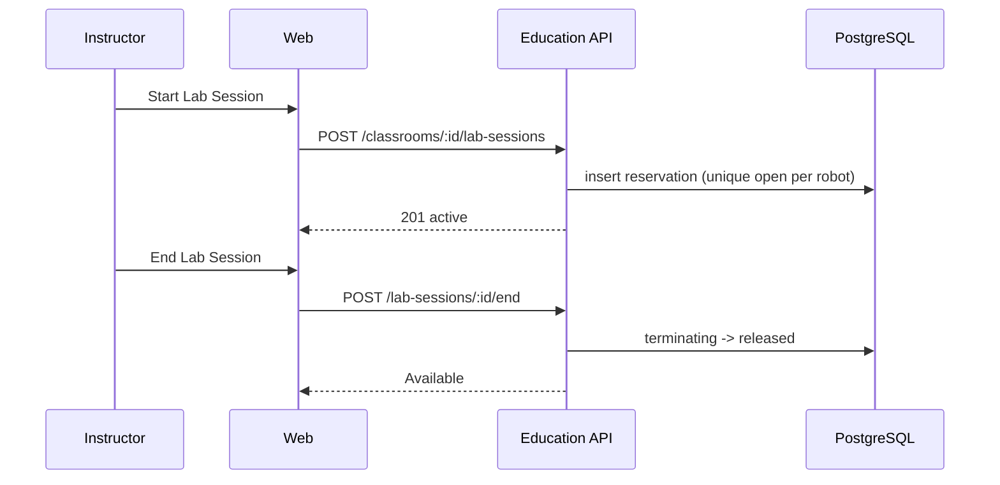
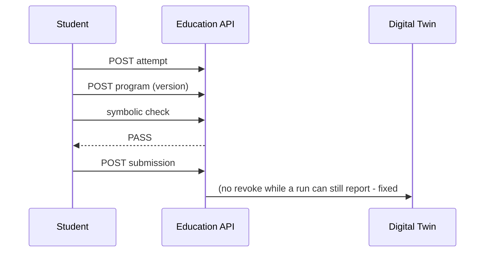
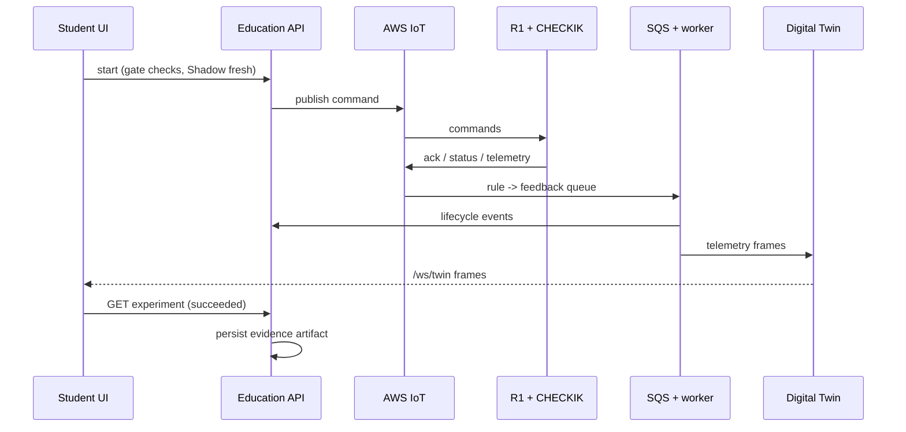
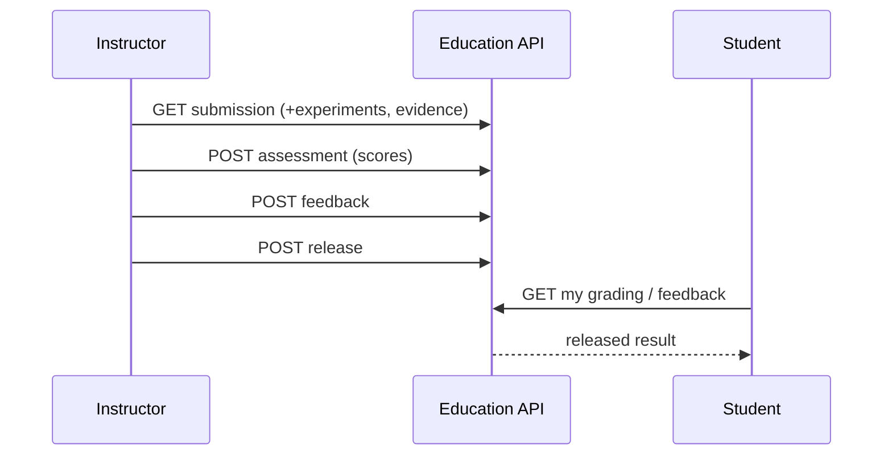

# WF01–WF04 execution runbook

> Correction (2026-11-27 late): the approved definitions are WF-01 *School Administration & Robot Resource Allocation*, WF-02 *Learning & Assignment Management*, WF-03 *Robot Experiment Execution*, WF-04 *AI/Data Integration & Teacher Review*. The Lab Session below is the 2026-11-27 *refinement* of WF-01/WF-03 authorization, not a separate workflow. The authoritative per-workflow definition is `WF01_WF04_DEFINITION_PACKAGE.md`.

Exactly four registered workflows. All run against Production with synthetic data (`PRODUCTION_TEST_DATA_MANIFEST.md`). Base API `https://api.skynex.best/api/v1`. Result of each as of Production `43dcb60` is in `PRODUCTION_TEST_CASE_MATRIX.md`.

## WF01 — Robot resource allocation and Lab Session
- **Actors:** System Admin (allocation), Instructor (session), Student (eligibility).
- **Trigger:** class needs the shared SO-101 robot.
- **Scenarios:** (S1) normal start→use→end; (S2) second class tries the same robot → rejected; (S3) extend; (S4) End while a run is active → safe-stop, quarantined until Edge confirms; (S5) School Admin force end.
- **Endpoints:** `GET /education-admin/classrooms/:id/eligible-robots`, `GET|POST /classrooms/:id/lab-sessions`, `POST /lab-sessions/:id/{extend,stop-execution,end,force-end}`.
- **Tables / states:** `classroom_lab_sessions` (`active → terminating → released`, or `quarantined`); partial unique index = one open reservation per robot; robot allocation, entitlement.
- **MQTT:** `…/commands` `cancel` on stop/end.
- **Acceptance:** robot shows "Reserved for this classroom"; student eligibility changes `LAB_SESSION_NOT_ACTIVE`→eligible; after End robot is Available and student is blocked again; reservation released. **Result: PASS (S1).**

## WF02 — Student assignment, program and submission
- **Actors:** Student, Instructor (receives).
- **Trigger:** assigned classroom assignment.
- **Scenarios:** (S1) Blockly program → version → schematic → symbolic check PASS → submit; (S2) symbolic FAIL blocks robot step; (S3) draft autosave.
- **Endpoints:** `POST /classroom-assignments/:id/attempts`, `PUT /me/attempts/:id/draft`, `POST /me/attempts/:id/program`, `POST /me/attempts/:id/knowledge-check`, `POST /me/attempts/:id/submission`.
- **Tables:** attempts, program versions, submissions. **State:** `in_progress → submitted`.
- **Acceptance:** symbolic PASS recorded, submission visible to instructor. **Result: PASS.**

## WF03 — Simulated robot run via AWS IoT (Education Platform scope)
- **Actors:** Student, Instructor (session), Edge (R1 + CHECKIK fake follower), Digital Twin.
- **Trigger:** student confirms simulation checklist in Robot Lab.
- **Start gate:** symbolic PASS + entitlement + allocation + open Lab Session for the student's classroom + safety profile + fresh Shadow (`MOCK_RUNTIME`, `hardwareEnabled=false`).
- **Scenarios:** (S1) success; (S2) Stop Execution; (S3) Edge offline → blocked; (S4) concurrent second student → blocked; (S5) expiry; (S6) disconnect during run.
- **Endpoints:** `GET /me/attempts/:id/physical-execution-eligibility`, `POST /me/attempts/:id/physical-executions/start`, `GET /me/physical-executions/:id`, `POST …/stop`, `POST /robots/:attemptId/digital-twin/viewer-scope`, `GET /me/experiments/:id/artifacts`.
- **Tables:** `learning_experiments` (`queued→running→succeeded|failed|cancelled`), `learning_experiment_events` (`physical_execution_prepared, queued, iot_ack_acknowledged, iot_status_executing, iot_status_completed, simulation_telemetry_latest`), artifacts (`vista.experiment.telemetry.v1`).
- **MQTT:** publish `…/commands` (QoS1); Edge publishes `…/ack`, `…/status`, `…/telemetry`; IoT rule → SQS feedback queue → `iot-feedback-worker`; worker → Twin `/internal/simulation-telemetry`; browser `/ws/twin` (`vista.twin.<token>` subprotocol).
- **Acceptance:** run `succeeded`, provenance `MOCK_RUNTIME/fake_follower/physical:false`, correlated events, Twin frames, no 403, evidence artifact retrievable by student and instructor. **Result: lifecycle + Twin PASS; evidence artifact missing on `43dcb60` → fix #257 pending deploy.**

## WF04 — Instructor evidence review, grading and release
- **Actors:** Instructor, Student.
- **Trigger:** submission present.
- **Scenarios:** (S1) open submission + evidence → rubric assessment → feedback → release → student views; (S2) edit after release rejected (`GRADE_RELEASED`); (S3) reopen grading.
- **Endpoints:** `GET /submissions/:id`, `GET /submissions/:id/experiments/:eid/artifacts/:aid/download`, `POST /submissions/:id/assessment`, `POST /submissions/:id/feedback`, `POST /submissions/:id/release`, `POST /attempts/:id/grading/reopen`, student `GET /me/submissions/:id/feedback`, `GET /me/attempts/:id/grading`.
- **State:** draft → released (immutable except reopen).
- **Acceptance:** student sees released grade and feedback; unauthorized users cannot read evidence. **Result: feedback + release PASS; numeric rubric and evidence opening NOT RUN on the new submission.**

