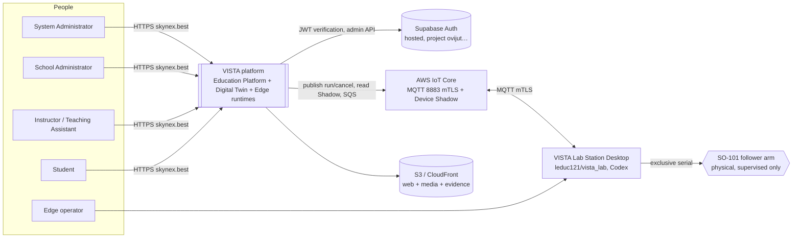

# 1. System context

**Actors and trust boundaries.** The Education API is authoritative for organization entitlement, classroom allocation, Classroom Lab Session, student eligibility and experiment authorization. The Edge runtime is authoritative for hardware safety, exclusive physical control, watchdog, emergency stop and safe termination. Browsers never talk to AWS IoT or the robot. **Phase A (accepted configuration):** the Edge is R1 + CHECKIK fake follower (`MOCK_RUNTIME`, `hardwareEnabled=false`); physical commissioning is disabled.
