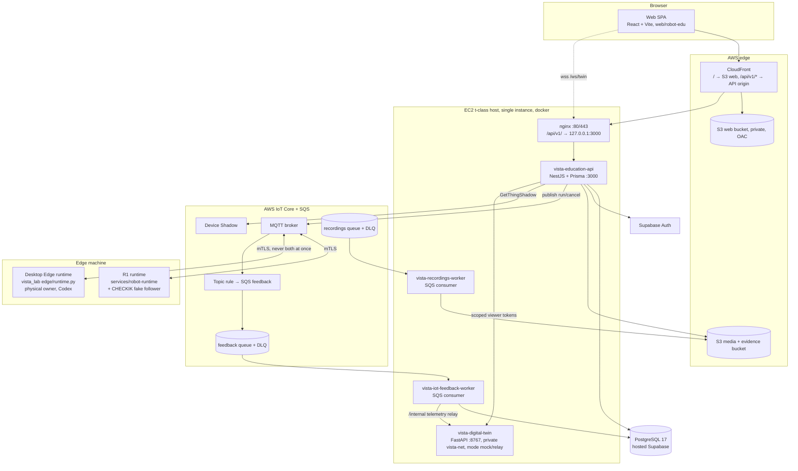

# 2. Container architecture

| Container | Source | Notes |
|---|---|---|
| Web SPA | `web/robot-edu` | Static bundle in S3 behind CloudFront; roles: admin, school_admin, teacher/TA, student |
| Education API | `services/education-api` | 25 controllers, 251 routes (`generated/api-routes.md`); Supabase JWT guard; SQL via Prisma raw queries |
| IoT feedback worker | `services/education-api/scripts/iot-feedback-worker.ts` | Consumes ack/status/telemetry events; simulation telemetry bridge → Twin when enabled |
| Recordings worker | same image | Physical recording events (S3 → DB) |
| Digital Twin | `services/digital-twin` | Private network only; viewer WebSocket `/ws/twin` with scoped tokens |
| R1 runtime | `services/robot-runtime` | HTTP + MQTT; fake follower via `web/checkIk/wf03_command_adapter.py`; reports `MOCK_RUNTIME` |
| Desktop Edge runtime | `leduc121/vista_lab` (Codex) | SO-101 adapter, Safety Controller, MQTT mTLS; **physical stop/execute integration pending (handoff §12, §14)** |
Only one runtime may hold the Thing's MQTT client identity at a time.
