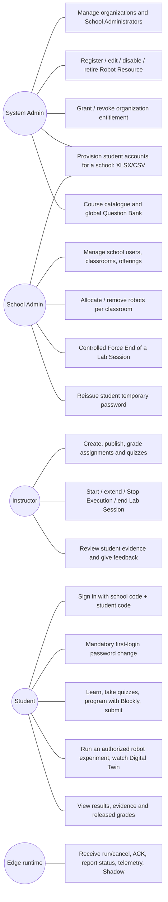

# 4. Consolidated use case model

| Use case | Actor | Implemented by (source) | Rule that matters |
|---|---|---|---|
| UC2, UC3 | System Admin | `education-admin/robot-resource.*`, web `/admin/robots` | resources retired, entitlements ended; never deleted; not shown as connected/ready |
| UC4 | System Admin, School Admin | `education-admin` `importUsers` + `parse-file`, web `/admin/students`, `/school/import` | organization from authorized context; random one-time passwords; idempotent; preview creates nothing |
| UC7 | School Admin | `EducationAdminService.allocateRobot/removeRobotAllocation` | many-to-many; entitlement required; allocation grants eligibility only |
| UC11 | Instructor | `learning/lab-session.*`, web classroom panel | one open reservation per robot (DB unique index); reserving never arms or moves hardware |
| UC8 | School Admin | `LabSessionService.forceEnd` | reason + confirmation; same safe termination; cannot override a physical safety state |
| UC14 | Student | `student-auth.*`, web `/student/change-password` | restricted session until the change; deep links and API blocked |
| UC16 | Student | `learning/physical-execution.service.ts` | Blockly prerequisite + symbolic PASS + entitlement + allocation + open Lab Session of the student's classroom + safety profile + fresh runtime |
| UC12 | Instructor | `learning/assessment.*`, evidence services | evidence is metadata/artifacts; no AI assessment is registered |
| UC18 | Edge | `docs/operations/EDGE_CONTRACT_HANDOFF_20261126.md` | Edge owns safety; ACK/terminal status rules in §7 |
