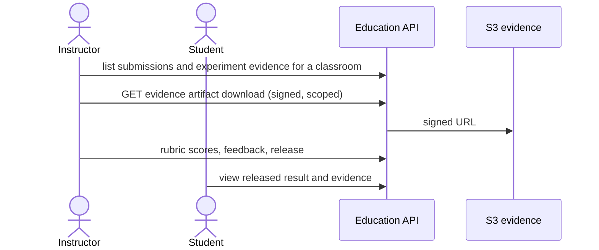

# 5. WF01–WF04 sequence diagrams (from the implemented services)

## WF01 — Robot entitlement, allocation and Lab Session
```mermaid
sequenceDiagram
  actor SA as System Admin
  actor SCH as School Admin
  actor INS as Instructor
  participant API as Education API
  participant DB as PostgreSQL
  SA->>API: POST /education-admin/robots (serial, name)
  API->>DB: INSERT robots (status available; commissioned=false)
  SA->>API: POST /education-admin/robots/{id}/entitlements {organizationId}
  API->>DB: INSERT org_entitlements (reject duplicate active)
  SCH->>API: POST /education-admin/classrooms/{id}/robot-allocations {robotId}
  API->>DB: lock robot+entitlement; INSERT learning_classroom_robot_allocations (UNIQUE classroom,robot)
  INS->>API: POST /classrooms/{id}/lab-sessions {robotId}
  API->>DB: advisory lock(robot); check allocation, entitlement, status, no open session, no active control
  API->>DB: INSERT classroom_lab_sessions(active) -- partial unique: one open per robot
  API-->>INS: active session (no arming, no command)
```

## WF02 — Assignment lifecycle
```mermaid
sequenceDiagram
  actor INS as Instructor
  actor STU as Student
  participant API as Education API
  participant DB as PostgreSQL
  INS->>API: create assignment draft, rubric (classrooms/{id}/assignments)
  INS->>API: publish to classroom
  API->>DB: learning_classroom_assignments status=published
  STU->>API: start attempt, save Blockly program (ProgramVersion), submit
  API->>DB: attempts, programs, program_versions, submissions
  INS->>API: grade, feedback, release (assessment endpoints)
  API->>DB: grading released_at; student sees score and feedback
```

## WF03 — Authorized robot experiment (Phase A: R1 + CHECKIK; same contract for the Desktop)
```mermaid
sequenceDiagram
  actor STU as Student
  participant WEB as Web
  participant API as Education API
  participant DB as PostgreSQL
  participant IOT as AWS IoT Core
  participant EDGE as Edge runtime (R1 / Desktop)
  participant Q as SQS feedback
  participant W as Feedback worker
  participant TW as Digital Twin
  STU->>WEB: Run (explicit safety confirmation)
  WEB->>API: POST /me/attempts/{id}/physical-executions/start
  API->>DB: lock(robot); re-resolve scope: symbolic PASS, entitlement, allocation, open Lab Session of THIS classroom, safety profile
  API->>DB: unconfirmed cloud timeout check (ROBOT_STOP_UNCONFIRMED); control_session + experiment + iot_command_lifecycle
  API->>IOT: GetThingShadow (fresh, MOCK_RUNTIME/hardwareEnabled=false for simulation)
  API->>IOT: publish run command (kind run, sequence, expiry)
  IOT->>EDGE: commands topic
  EDGE-->>IOT: ack accepted, status executing
  EDGE-->>IOT: status telemetry (correlated frames), then completed/failed
  IOT->>Q: topic rule (ack/status)
  Q->>W: events
  W->>DB: lifecycle + control session + experiment terminal state
  W->>TW: relay validated simulation frames
  WEB->>API: POST /me/attempts/{id}/digital-twin/viewer-scope (attempt-bound, 60 s)
  WEB-->>TW: wss /ws/twin (token in subprotocol; only this attempt's relayed frames)
  WEB->>API: GET /me/physical-executions/{id} (status)
  API->>DB: when succeeded: read simulation_telemetry_latest, store evidence JSON in S3 + artifact row (skipped, evidence=unavailable, if the object store refuses)
```
Stop Execution (instructor) publishes `kind:"cancel"` for the active command; the reservation is released only by the Edge's own terminal status or a fresh idle Shadow (`edgeStopUnconfirmed`).

## WF04 — Instructor review of evidence

Scope: WF04 is teacher review of evidence and feedback; no AI assessment is registered or implemented.
