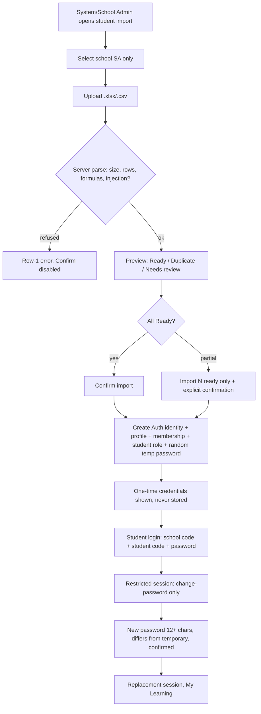
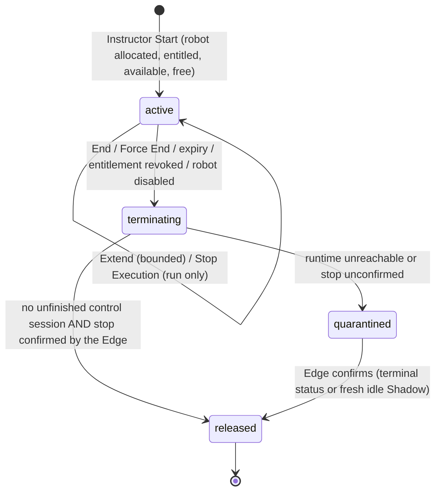
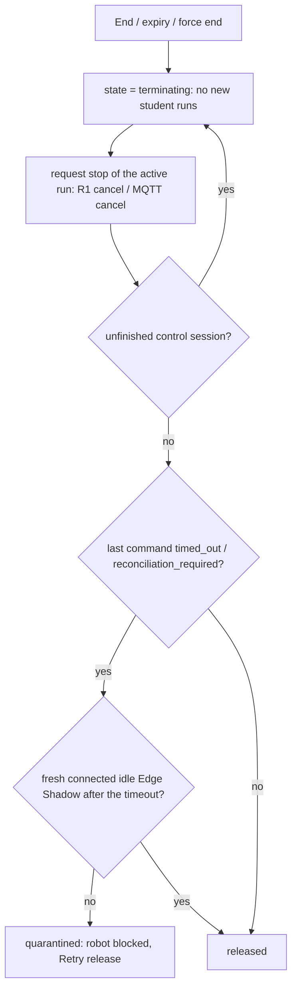

# 6. Activity flows

## Student provisioning and first login


## Classroom Lab Session lifecycle


## Experiment command lifecycle (iot_command_lifecycles)
```mermaid
stateDiagram-v2
  [*] --> pending_publish --> publishing --> queued: published
  publishing --> publish_failed: definite failure
  publishing --> reconciliation_required: outcome unknown (never replayed)
  queued --> acknowledged: ack accepted
  acknowledged --> executing: status executing
  executing --> completed: Edge terminal
  executing --> failed: Edge terminal / rejected
  queued --> timed_out: cloud gave up (NOT a safety proof)
```

## Safe release rule

