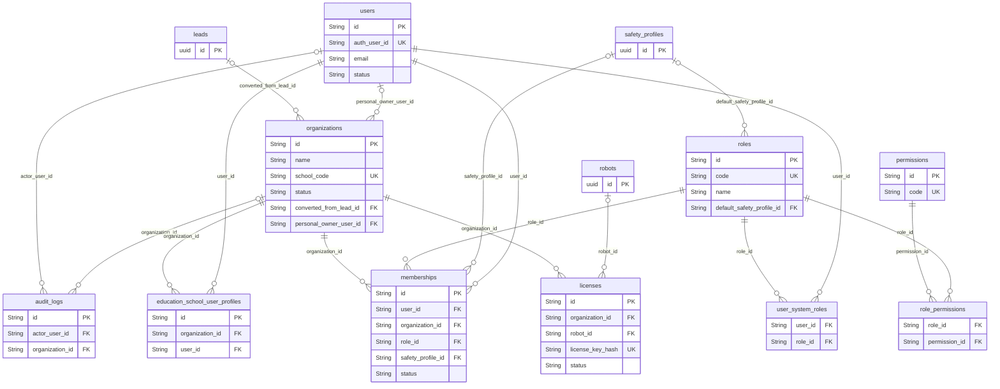
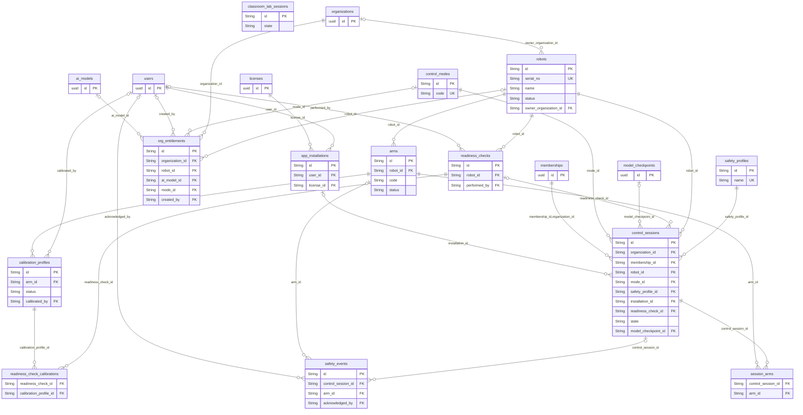
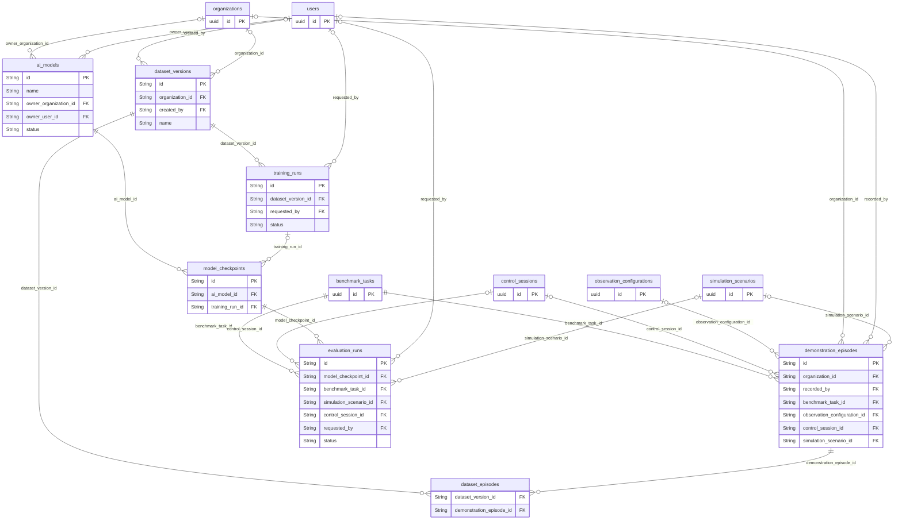
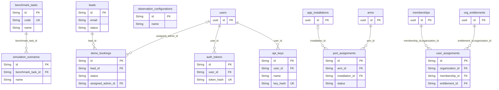

# Logical ERD (generated from `schema.prisma`)

88 tables. Only identifiers, foreign keys and status/state columns are drawn; every column is listed in `database-schema.md`. One diagram per domain; cross-domain foreign keys appear as an entity with `FK` attributes only. `classroom_lab_sessions` is released by migration S (not yet in the Production ledger).

## Identity domain (10 tables)

## Learning domain (49 tables)

```mermaid
erDiagram
  learning_activities {
    String id PK
    String section_id FK
    String title
    String status
  }
  learning_activity_objectives {
    String activity_id FK
    String objective_id FK
  }
  learning_activity_progress {
    String id PK
    String learner_user_id FK
    String lesson_id FK
    String activity_definition_id FK
    String status
  }
  learning_assessment_scores {
    String assessment_id FK
    String criterion_id FK
  }
  learning_assessments {
    String id PK
    String submission_id FK
    String reviewer_user_id FK
  }
  learning_assignment_attempts {
    String id PK
    String classroom_assignment_id FK
    String learner_user_id FK
    String program_id FK
    String status
    String grading_released_by FK
  }
  learning_assignment_question_versions {
    String assignment_id FK
    String question_id FK
    String question_version_id FK
  }
  learning_assignments {
    String id PK
    String lesson_id FK
    String challenge_id FK
    String title
  }
  learning_challenge_conditions {
    String id PK
    String challenge_id FK
  }
  learning_challenge_objects {
    String id PK
    String challenge_id FK
  }
  learning_challenges {
    String id PK
    String title
    String creator_user_id FK
    String organization_id FK
    String status
  }
  learning_classroom_assignments {
    String id PK
    String classroom_id FK
    String assignment_id FK
    String published_by FK
    String status
  }
  learning_classroom_members {
    String id PK
    String classroom_id FK
    String user_id FK
    String membership_id FK
    String status
  }
  learning_classroom_robot_allocations {
    String id PK
    String classroom_id FK
    String robot_id FK
    String created_by_user_id FK
  }
  learning_classrooms {
    String id PK
    String organization_id FK
    String offering_id FK
    String name
    String code
    String status
    String created_by FK
  }
  learning_competencies {
    String id PK
    String code UK
    String title
  }
  learning_competency_progress {
    String id PK
    String learner_user_id FK
    String competency_id FK
  }
  learning_course_offerings {
    String id PK
    String course_id FK
    String organization_id FK
    String code
    String title
    String status
    String created_by FK
  }
  learning_courses {
    String id PK
    String level_id FK
    String organization_id FK
    String title
    String status
    String created_by FK
  }
  learning_demonstration_annotations {
    String id PK
    String demonstration_episode_id FK
  }
  learning_demonstration_segments {
    String id PK
    String demonstration_episode_id FK
  }
  learning_enrollments {
    String id PK
    String course_id FK
    String learner_user_id FK
    String status
    String offering_id FK
    String classroom_id FK
  }
  learning_experiment_artifacts {
    String id PK
    String experiment_id FK
  }
  learning_experiment_comparisons {
    String id PK
    String learner_user_id FK
    String challenge_id FK
    String title
  }
  learning_experiment_events {
    BigInt id PK
    String experiment_id FK
  }
  learning_experiments {
    String id PK
    String challenge_id FK
    String submission_id FK
    String learner_user_id FK
    String status
    String control_session_id FK
    String demonstration_episode_id FK
    String evaluation_run_id FK
  }
  learning_feedback {
    String id PK
    String submission_id FK
    String attempt_id FK
    String author_user_id FK
    String parent_feedback_id FK
  }
  learning_lesson_prerequisites {
    String lesson_id FK
    String prerequisite_lesson_id FK
  }
  learning_lesson_progress {
    String id PK
    String learner_user_id FK
    String lesson_id FK
    String status
  }
  learning_lessons {
    String id PK
    String course_id FK
    String title
  }
  learning_levels {
    String id PK
    String code UK
    String title
    Int ordinal UK
  }
  learning_media_assets {
    String id PK
    String course_id FK
    String object_key UK
    String status
    String created_by FK
  }
  learning_objective_competencies {
    String objective_id FK
    String competency_id FK
  }
  learning_objectives {
    String id PK
    String lesson_id FK
    String code
  }
  learning_program_versions {
    String id PK
    String program_id FK
    String created_by FK
  }
  learning_programs {
    String id PK
    String owner_user_id FK
    String assignment_id FK
    String title
  }
  learning_question_version_objectives {
    String question_version_id FK
    String objective_id FK
  }
  learning_question_versions {
    String id PK
    String question_id FK
    String status
    String authored_by FK
    String reviewed_by FK
    String published_by FK
  }
  learning_questions {
    String id PK
    String organization_id FK
    String code
    String course_id FK
    String lesson_id FK
    String created_by FK
  }
  learning_quiz_attempt_grading {
    String attempt_id PK
  }
  learning_reflections {
    String id PK
    String submission_id FK
    String experiment_id FK
    String learner_user_id FK
  }
  learning_rubric_criteria {
    String id PK
    String assignment_id FK
    String title
  }
  learning_sections {
    String id PK
    String lesson_id FK
    String title
    String status
  }
  learning_submission_backfill_audit {
    String id PK
  }
  learning_submission_files {
    String id PK
    String attempt_id FK
    String assignment_id FK
    String learner_user_id FK
    String object_key UK
    String status
  }
  learning_submissions {
    String id PK
    String assignment_id FK
    String learner_user_id FK
    String program_id FK
    String program_version_id FK
    String status
    String attempt_id FK
  }
  learning_symbolic_evaluations {
    String id PK
    String experiment_id FK
    String submission_id FK
    String program_version_id FK
    String requested_by_user_id FK
    String fingerprint UK
  }
  learning_vla_action_steps {
    String id PK
    String interaction_id FK
  }
  learning_vla_interactions {
    String id PK
    String experiment_id FK
    String learner_user_id FK
  }
  learning_sections ||--o{ learning_activities : "section_id"
  learning_activities ||--o{ learning_activity_objectives : "activity_id"
  learning_objectives ||--o{ learning_activity_objectives : "objective_id"
  users ||--o{ learning_activity_progress : "learner_user_id"
  learning_lessons ||--o{ learning_activity_progress : "lesson_id"
  learning_activities |o--o{ learning_activity_progress : "activity_definition_id"
  learning_assessments ||--o{ learning_assessment_scores : "assessment_id"
  learning_rubric_criteria ||--o{ learning_assessment_scores : "criterion_id"
  users |o--o{ learning_assessments : "reviewer_user_id"
  learning_submissions ||--o{ learning_assessments : "submission_id"
  users |o--o{ learning_assignment_attempts : "grading_released_by"
  learning_classroom_assignments ||--o{ learning_assignment_attempts : "classroom_assignment_id"
  users ||--o{ learning_assignment_attempts : "learner_user_id"
  learning_programs |o--o{ learning_assignment_attempts : "program_id"
  learning_assignments ||--o{ learning_assignment_question_versions : "assignment_id"
  learning_question_versions ||--o{ learning_assignment_question_versions : "question_version_id"
  learning_questions ||--o{ learning_assignment_question_versions : "question_id"
  learning_challenges |o--o{ learning_assignments : "challenge_id"
  learning_lessons ||--o{ learning_assignments : "lesson_id"
  learning_challenges ||--o{ learning_challenge_conditions : "challenge_id"
  learning_challenges ||--o{ learning_challenge_objects : "challenge_id"
  users |o--o{ learning_challenges : "creator_user_id"
  organizations |o--o{ learning_challenges : "organization_id"
  learning_assignments ||--o{ learning_classroom_assignments : "assignment_id"
  learning_classrooms ||--o{ learning_classroom_assignments : "classroom_id"
  users |o--o{ learning_classroom_assignments : "published_by"
  learning_classrooms ||--o{ learning_classroom_members : "classroom_id"
  memberships |o--o{ learning_classroom_members : "membership_id"
  users ||--o{ learning_classroom_members : "user_id"
  learning_classrooms ||--o{ learning_classroom_robot_allocations : "classroom_id"
  robots ||--o{ learning_classroom_robot_allocations : "robot_id"
  users ||--o{ learning_classroom_robot_allocations : "created_by_user_id"
  users |o--o{ learning_classrooms : "created_by"
  learning_course_offerings ||--o{ learning_classrooms : "offering_id"
  organizations ||--o{ learning_classrooms : "organization_id"
  learning_competencies ||--o{ learning_competency_progress : "competency_id"
  users ||--o{ learning_competency_progress : "learner_user_id"
  learning_courses ||--o{ learning_course_offerings : "course_id"
  users |o--o{ learning_course_offerings : "created_by"
  organizations ||--o{ learning_course_offerings : "organization_id"
  users |o--o{ learning_courses : "created_by"
  learning_levels |o--o{ learning_courses : "level_id"
  organizations |o--o{ learning_courses : "organization_id"
  demonstration_episodes ||--o{ learning_demonstration_annotations : "demonstration_episode_id"
  demonstration_episodes ||--o{ learning_demonstration_segments : "demonstration_episode_id"
  learning_classrooms |o--o{ learning_enrollments : "classroom_id"
  learning_courses ||--o{ learning_enrollments : "course_id"
  learning_course_offerings |o--o{ learning_enrollments : "offering_id"
  users ||--o{ learning_enrollments : "learner_user_id"
  learning_experiments ||--o{ learning_experiment_artifacts : "experiment_id"
  learning_challenges |o--o{ learning_experiment_comparisons : "challenge_id"
  users |o--o{ learning_experiment_comparisons : "learner_user_id"
  learning_experiments ||--o{ learning_experiment_events : "experiment_id"
  learning_challenges |o--o{ learning_experiments : "challenge_id"
  control_sessions |o--o{ learning_experiments : "control_session_id"
  demonstration_episodes |o--o{ learning_experiments : "demonstration_episode_id"
  evaluation_runs |o--o{ learning_experiments : "evaluation_run_id"
  users ||--o{ learning_experiments : "learner_user_id"
  learning_submissions |o--o{ learning_experiments : "submission_id"
  learning_assignment_attempts |o--o{ learning_feedback : "attempt_id"
  users ||--o{ learning_feedback : "author_user_id"
  learning_feedback |o--o{ learning_feedback : "parent_feedback_id"
  learning_submissions |o--o{ learning_feedback : "submission_id"
  learning_lessons ||--o{ learning_lesson_prerequisites : "lesson_id"
  learning_lessons ||--o{ learning_lesson_prerequisites : "prerequisite_lesson_id"
  learning_lessons ||--o{ learning_lesson_progress : "lesson_id"
  users ||--o{ learning_lesson_progress : "learner_user_id"
  learning_courses ||--o{ learning_lessons : "course_id"
  learning_courses ||--o{ learning_media_assets : "course_id"
  users |o--o{ learning_media_assets : "created_by"
  learning_competencies ||--o{ learning_objective_competencies : "competency_id"
  learning_objectives ||--o{ learning_objective_competencies : "objective_id"
  learning_lessons ||--o{ learning_objectives : "lesson_id"
  users |o--o{ learning_program_versions : "created_by"
  learning_programs ||--o{ learning_program_versions : "program_id"
  learning_assignments |o--o{ learning_programs : "assignment_id"
  users ||--o{ learning_programs : "owner_user_id"
  learning_question_versions ||--o{ learning_question_version_objectives : "question_version_id"
  learning_objectives ||--o{ learning_question_version_objectives : "objective_id"
  learning_questions ||--o{ learning_question_versions : "question_id"
  users ||--o{ learning_question_versions : "authored_by"
  users |o--o{ learning_question_versions : "reviewed_by"
  users |o--o{ learning_question_versions : "published_by"
  organizations |o--o{ learning_questions : "organization_id"
  learning_courses ||--o{ learning_questions : "course_id"
  learning_lessons ||--o{ learning_questions : "lesson_id"
  users ||--o{ learning_questions : "created_by"
  learning_assignment_attempts ||--o{ learning_quiz_attempt_grading : "attempt_id"
  learning_experiments |o--o{ learning_reflections : "experiment_id"
  learning_submissions |o--o{ learning_reflections : "submission_id"
  users ||--o{ learning_reflections : "learner_user_id"
  learning_assignments ||--o{ learning_rubric_criteria : "assignment_id"
  learning_lessons ||--o{ learning_sections : "lesson_id"
  learning_assignment_attempts ||--o{ learning_submission_files : "attempt_id"
  learning_assignments ||--o{ learning_submission_files : "assignment_id"
  users ||--o{ learning_submission_files : "learner_user_id"
  learning_assignment_attempts |o--o{ learning_submissions : "attempt_id"
  learning_assignments ||--o{ learning_submissions : "assignment_id"
  users ||--o{ learning_submissions : "learner_user_id"
  learning_programs |o--o{ learning_submissions : "program_id"
  learning_program_versions |o--o{ learning_submissions : "program_version_id"
  learning_experiments ||--o{ learning_symbolic_evaluations : "experiment_id"
  learning_submissions ||--o{ learning_symbolic_evaluations : "submission_id"
  learning_program_versions ||--o{ learning_symbolic_evaluations : "program_version_id"
  users ||--o{ learning_symbolic_evaluations : "requested_by_user_id"
  learning_vla_interactions ||--o{ learning_vla_action_steps : "interaction_id"
  learning_experiments ||--o{ learning_vla_interactions : "experiment_id"
  users |o--o{ learning_vla_interactions : "learner_user_id"
  control_sessions {
    uuid id PK
  }
  demonstration_episodes {
    uuid id PK
  }
  evaluation_runs {
    uuid id PK
  }
  memberships {
    uuid id PK
  }
  organizations {
    uuid id PK
  }
  robots {
    uuid id PK
  }
  users {
    uuid id PK
  }
```

## Robotics domain (13 tables)

## Ai domain (7 tables)

## Other domain (9 tables)

