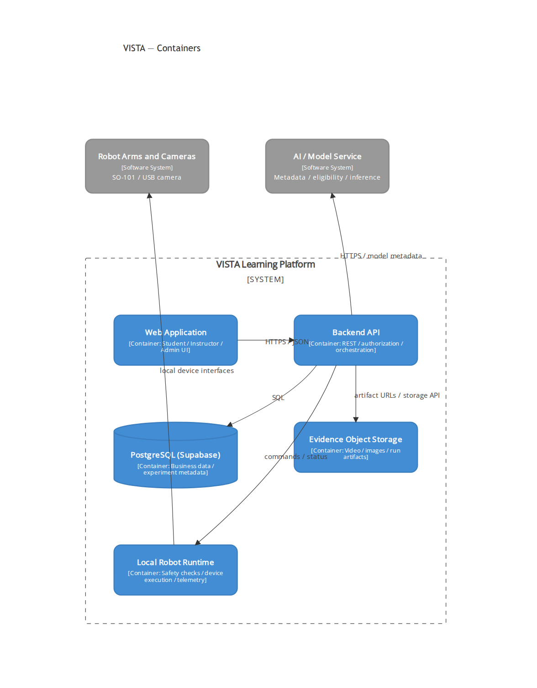

# C4 Level 2 — Container Diagram

Source: draw.io page 02 (Report 4, Figure 02).

> **Open decision:** verify whether Local Robot Runtime is deployed inside or outside the VISTA system boundary, and distinguish intended architecture from currently running components.
